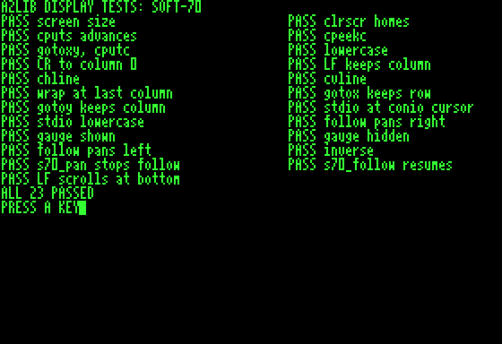

# a2lib

A C library for the Apple II+, built on [cc65](https://github.com/cc65/cc65)'s
`apple2` target. It fills the gaps that keep cc65 programs from being
full-featured on a stock II+:

- **DOS 3.3 file I/O.** Stock cc65 supports file I/O only under ProDOS;
  under DOS 3.3, `open` fails with `ENOSYS`. a2lib implements cc65's POSIX
  layer on top of the DOS 3.3 File Manager, so `open`, `read`, `write` and
  stdio work under both DOSes with the same behavior.
- **Display backends**, selected at link time. Conio and console output
  use a Videx VideoTerm in slot 3 when present. Without one, a program
  falls back to either the stock 40-column screen or a 40-column window
  onto an 80 × 24 screen, which follows the cursor or pans under program
  control, or the optional "Soft-70" display: 70 of the 80 columns, with
  lowercase, drawn on the hi-res screen.
- **Reflow.** stdio output can be word-wrapped at the visible width,
  switched on and off as a program runs (`include/a2reflow.h`), for
  running text such as documents.
- **Cooperative timer and software clock.** A stock II+ has no timer, so
  a2lib counts time while programs wait in the library (for keys,
  network packets, or explicitly), and runs timer callbacks then:
  one-shot or periodic, for regular "go" intervals and timeouts. Under
  DOS 3.3, `time()` and `clock_gettime` return the up-time until a
  program sets the clock, for example from an Internet time server, and
  IP65 programs can use it as their timer (`include/a2timer.h`).
- **DOS 3.3 interrupts.** Stock cc65 can only install interrupt
  handlers under ProDOS. a2lib installs them under DOS 3.3 too, keeping
  the Language Card banking intact across interrupts.

The first programs built on it are a telnet terminal and a Gopher client
for the Uthernet II.

## Status

- **Increment 1** of the DOS 3.3 file layer passes all its tests under
  DOS 3.3: `open`, `close`, `read` and `write`, including `O_APPEND`,
  `O_TRUNC` and `O_EXCL`, for T, B, A and I files, plus stdio on top.
- **Increment 2** adds `lseek`, `remove`, `rename` and `stat`, and also
  passes all its tests under DOS 3.3.
- **Increment 3** adds directories (`opendir`, `readdir`, `closedir`,
  `rewinddir`) over the DOS 3.3 catalog, and `st_blocks` in `stat`, and
  also passes all its tests under DOS 3.3.
- **Increment 4** adds interrupt support under DOS 3.3 (cc65's
  interruptors, as used by the mouse and serial drivers), and also passes
  all its tests under DOS 3.3. The interrupt paths are tested with
  simulated interrupts until ReplicApple2Plus has a card that raises IRQ.
- **Increment 5** adds the VideoTerm backend (`lib/apple2-dos33-vt.lib`),
  and passes all its tests both with the card and on the 40-column
  fallback.
- **Increment 6** adds the 40-column window (`lib/apple2-dos33-vtwin.lib`),
  and passes all its tests, with and without the card.
- **Increment 7** adds the cooperative timer, the software clock, the
  40-column window's position gauge, and an IP65 timer driver. It passes
  all its tests under DOS 3.3 and the sim65 regression tests
  (`make simtest`).
- **Increment 8** adds the reflow filter, and passes all its tests on the
  stock screen, the VideoTerm and the 40-column window.
- **Increment 9** adds Soft-70 (`lib/apple2-dos33-vts70.lib`), on an
  80 × 24 screen model now shared with the 40-column window. It passes
  all its tests on the emulator, with and without the card, and the sim65
  regression tests.

## Building

Requires a **current cc65 built from source**. a2lib's `write.s` is derived
from cc65's own and depends on runtime symbols added in 2024
(`uppercasemask`), which older releases such as V2.19 don't have.

```sh
git clone https://github.com/cc65/cc65
make -C cc65 -j"$(nproc)"
export PATH="$PWD/cc65/bin:$PATH"

make          # lib/apple2-dos33.lib
make test     # also build/test/filetest
```

## Using the DOS 3.3 file layer

`lib/apple2-dos33.lib` is a complete replacement for cc65's `apple2.lib`,
built from the installed cc65's library with the DOS 3.3 modules swapped
in. Build with:

```sh
cl65 -t apple2 -I include -o prog prog.c lib/apple2-dos33.lib
```

`-I include` selects a2lib's DOS 3.3 `dirent.h`, which programs that use
the directory functions need. To use a Videx VideoTerm in slot 3 when one
is present, link one of these instead:

| Library | Without a VideoTerm |
|---|---|
| `lib/apple2-dos33-vt.lib` | The stock 40-column screen |
| `lib/apple2-dos33-vtwin.lib` | A 40-column window onto an 80 × 24 screen; see `include/c40win.h` |
| `lib/apple2-dos33-vts70.lib` | Soft-70: 70 columns of an 80 × 24 screen on hi-res page 1; see `include/soft70.h` |

Soft-70 programs must be linked with `--start-addr 0x4000`, above the
hi-res page; linking without it fails with a message saying so:

```sh
cl65 -t apple2 --start-addr 0x4000 -I include -o prog prog.c lib/apple2-dos33-vts70.lib
```

Soft-70 is drawn for monochrome monitors, as period hi-res text was.
`s70_font` loads 768-byte fonts in the period format (Soft Seventy, Flex
Type `.70` sets). The default font's source is `tools/s70font.txt`;
`tools/s70font.py` turns it into assembler source, a `.70` file or a
preview image.



While a program waits for a key, the cursor is the cell drawn in inverse,
blinking every 250 ms (steady if all four of a2lib's timer slots are in
use). After each pan, whether the view followed the cursor or the
program called `s70_pan`, a bar along the bottom scan line shows for a
second which columns are in view: dotted across all 80, solid over the 70
shown. And while Soft-70 runs, a marker in memory just before its 80 × 24
buffer lets an emulator copy the screen's text, all 80 columns of it --
ReplicApple2Plus's Copy Screen Text does -- since none of it is on the
text page; DESIGN.md 3.9 describes the marker.

Compiling with a2lib's `dirent.h` but linking without an a2lib library
fails at link time, so the two can't be mixed up silently.

Rebuild a2lib after updating cc65, so the stock modules it contains match
your toolchain.

Programs run on a 48K II+ under stock DOS 3.3 (ProDOS builds need 64K).
Behavior matches cc65 under ProDOS wherever DOS 3.3 can represent it, and
fails visibly where it can't:

| Topic | Behavior |
|---|---|
| File names | `"NAME"` uses the last-used slot and drive; `"NAME,S6,D2,V254"` selects them, as at the DOS prompt. Names are case-insensitive. |
| New files | Type from `_filetype`, in DOS 3.3's own codes (`include/dos33_filetype.h`): `DOS33_T_TXT`, `DOS33_T_BIN` (the default), `DOS33_T_BAS`, `DOS33_T_INT`, `DOS33_T_S`, `DOS33_T_REL`. ProDOS's codes don't apply: `PRODOS_T_TXT` is DOS 3.3's B. |
| T files | Stored as DOS 3.3 text (high bit set, CR line endings) and read back byte-for-byte as written. Bytes `$80`–`$FF` are rejected with `EINVAL`; use B files for 8-bit data. |
| B files | The 4-byte address/length header is hidden. `_auxtype` sets the load address; the length is exact. Files still `BLOAD` and `BRUN`. |
| Seeking | As under ProDOS, except that T files can be positioned past their end, to reach records of random-access files. Positions are limited to 16 bits. |
| Rename | The new name takes no suffixes, and an existing new name fails with `EEXIST`, as under ProDOS. |
| Directories | `opendir` takes a location, not a path: `""` or `"."` for the default drive, optionally with suffixes (`",D2"`). `struct dirent` has the name, DOS 3.3 type, lock bit and size in blocks and sectors; it omits the byte size, dates and aux type, which the catalog doesn't record (use `stat`). |
| Clock | `time()` and `clock_gettime` count the up-time until `clock_settime` sets the clock; `a2_clock_age` tells whether, and how long ago, it was set. |
| Errors | The same `errno` values as under ProDOS; `_oserror` holds DOS 3.3's own error numbers (the ones `ONERR` reports), and `_stroserror` gives DOS's messages. |

## Using the timer with IP65

Link `lib/a2lib-ip65.o` before IP65's libraries. It replaces IP65's
Apple II timer driver, which busy-waits about 33 ms on every
`timer_read`, with one that waits a single tick (about 3.9 ms) and
reports counted milliseconds:

```sh
cl65 -t apple2 -I include -o prog prog.c lib/a2lib-ip65.o ip65.lib a2uther2.lib lib/apple2-dos33.lib
```

## Testing

`test/filetest.c` checks every file-layer behavior above and prints a
`PASS` or `FAIL` line for each. Run it from a DOS 3.3 disk with a writable
disk in the default drive. `test/vttest.c` checks the display backends,
and `test/timertest.c` the timer and clock. The target test environment
is the [ReplicApple2Plus](https://github.com/sbabcoc/ReplicApple2Plus)
emulator.

`make emutest MASTER=path/to/DOS-3.3-System-Master.woz` runs every test
program on ReplicApple2Plus (1.8.0 or later) with its headless runner,
`replicapple2plus-run`, and AppleCommander's `ac`, with and without the
VideoTerm, and reports each run's result; screens go to `build/emu/`.
`RUNS="vttest s70test-vt"` runs only those; `RUNNER=` and `AC=` give the
tools' paths if they aren't on `PATH`. `SNAP=folder` also saves a picture
of each run's last screen there, as ReplicApple2Plus's window shows it,
on the monitor `MONITOR=` names (`green` by default; `color`, `white` or
`amber`), with ReplicApple2Plus 1.11.0 or later. `make screenshots`
(with `MASTER=`, as for `make emutest`) captures the picture above that
way, into `docs/images`.

`test/nettest.c` runs the IP65 timer driver with IP65 itself, on the
Uthernet II: it leases an address, echoes a line through a server on the
host, and times the server's two-second delay. `make emutest` includes it
when given an IP65 checkout with its TCP library and Uthernet II driver
built, and the folder holding the
[Uthernet2](https://github.com/sbabcoc/Uthernet2) plug-in jar
(ReplicApple2Plus 1.9.0 or later, and `python3` for the server):

```sh
make emutest MASTER=... IP65=path/to/ip65 UTHERNET2=path/to/plugins
```

`make simtest` runs regression tests for the timer, the window's gauge,
the reflow filter and Soft-70 in cc65's 6502 simulator, `sim65`, with no
Apple II needed.

## Documentation

[DESIGN.md](DESIGN.md) records every design decision, the reasoning behind
it, the alternatives that were rejected, and the sources each fact was
verified against.

## Upstream

The DOS 3.3 file layer is intended for contribution to cc65;
[docs/cc65-proposal.md](docs/cc65-proposal.md) is the proposal to the
cc65 maintainers. a2lib keeps cc65's ProDOS behavior unchanged; proposed ProDOS
changes are raised with the cc65 maintainers instead.

## License

a2lib is distributed under the [zlib license](LICENSE), the same license as
cc65, so its code can move into cc65 without relicensing. Files copied or
derived from cc65 keep their original copyright notices.

## Acknowledgments

`libsrc/dos33/filedes.inc`, `mli.inc` and `write.s` are copied or derived
from cc65 (zlib license); see
[libsrc/dos33/VENDORED.md](libsrc/dos33/VENDORED.md). File Manager details
come from *Beneath Apple DOS* by Don Worth and Pieter Lechner.
